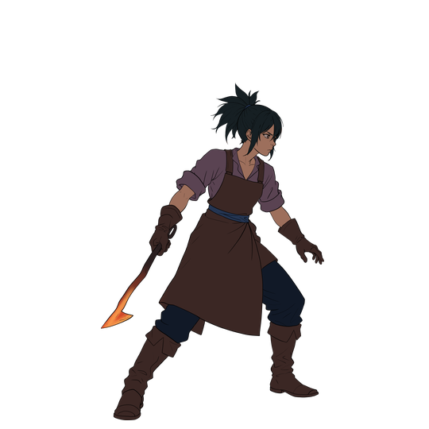
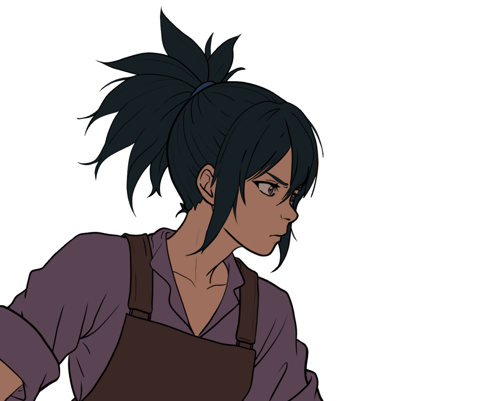

# Apprentice

## Sprite

## Headshot

## Name

Apprentice

## Class Name

Apprentice

## Description

A sword-wielding apprentice.

## Attack

1

## Defense

50

## Magic Attack

1

## Magic Defense

50

## My Health

500

## Is Placeholder

Yes

## Weapon

Sword

## Basic Attack

[Slash](../abilities/apprenticeslash.md)

## Abilities

- [Flurry](../abilities/flurry.md)
- [Cleave](../abilities/cleave.md)
- [Stab](../abilities/stab.md)
- [Reckless Strike](../abilities/recklessstrike.md)

## Ultimate

[Reckless Strike](../abilities/recklessstrike.md)

