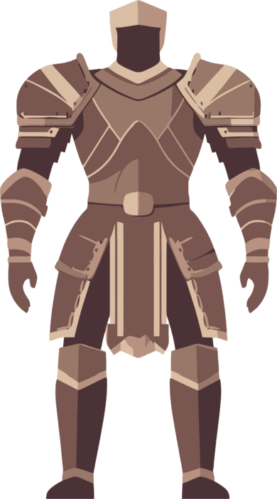
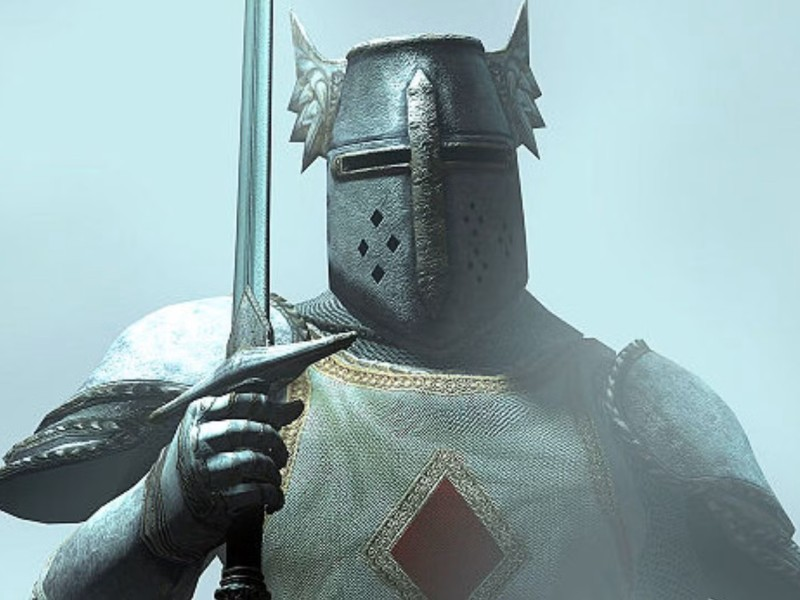

# Mage

## Sprite

## Headshot

## Name

Mage

## Class Name

Mage

## Description

A spellcaster wielding a grimoire.

## Attack

1

## Defense

50

## Magic Attack

1

## Magic Defense

25

## My Health

500

## Is Placeholder

Yes

## Weapon

Grimoire

## Basic Attack

[Magic Bolt](../abilities/magicbolt.md)

## Abilities

- [Fire Ball](../abilities/fireball.md)
- [Lightning Bolt](../abilities/lightningbolt.md)
- [Spell Charge](../abilities/spellcharge.md)

## Ultimate

[Quake](../abilities/quake.md)

