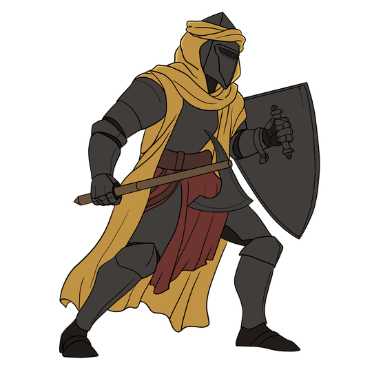
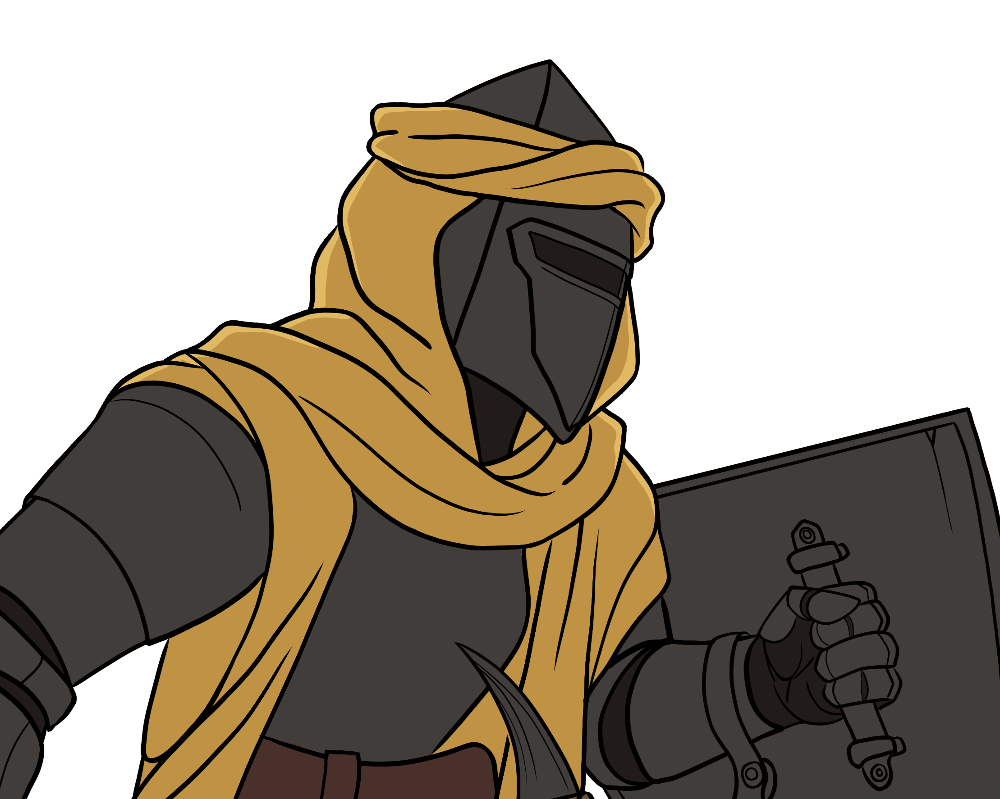

# Woodsman

## Sprite

## Headshot

## Name

The Woodsman

## Class Name

Woodsman

## Description

A shield-bearing woodsman.

## Attack

1

## Defense

50

## Magic Attack

0

## Magic Defense

25

## My Health

500

## Is Placeholder

Yes

## Weapon

Big Ass Shield

## Basic Attack

[Dropkick](../abilities/woodsmandropkick.md)

## Abilities

- [Charge](../abilities/charge.md)
- [Counter](../abilities/counter.md)
- [Taunt](../abilities/taunt.md)
- [Battle Cry](../abilities/battlecry.md)

## Ultimate

[Battle Cry](../abilities/battlecry.md)

